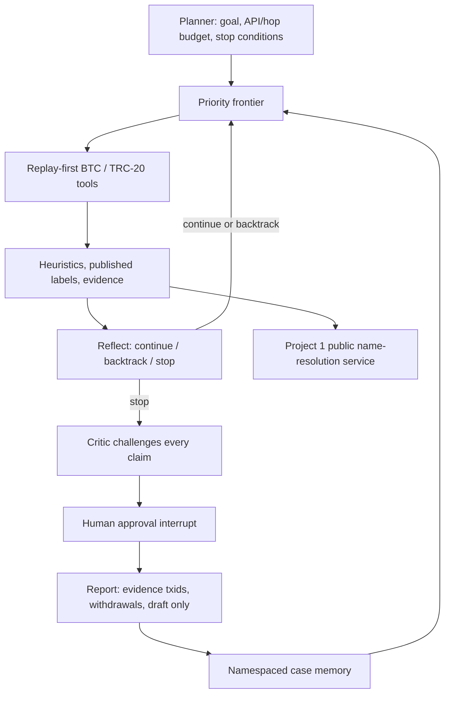

# Follow the Money — implementation plan

Research prototype for human investigators, not a screening service, an identity
resolver, or a finding of wrongdoing. Bitcoin UTXO and USDT TRC-20 are separate
data models. Published labels are attributed observations; scores and clusters
are hypotheses. No transaction signing, deanonymisation, exchange contact, or
authority contact exists in this project. Requests remain drafts.

## Authorization and engineering contract

The owner's end-to-end task authorizes implementation in the phases below,
bounded public downloads/API recording, dependency installation and local small
commits on `project-2`. It supersedes the earlier per-phase permission pauses;
each phase still gets a preflight, tests and an honest progress report. No push,
merge, paid compute, keys, login-gated downloads or public deployment is allowed.
Use the existing worktree as source of truth and `<linux-test-mirror>` as the
Linux test mirror. Environments are `<environment-root>/venv-p2` and `<environment-root>/qa-p2`.
Run pinned uv 0.13.5, Python 3.14, offline tests, Ruff and LF text checks.

Read first: `AGENTS.md`, the proposal's two projects, Microsoft 365 layer,
engineering and AI-agent guidance, and Project 1 review/service, locking, audit,
memory, API, MCP, observability and stack interfaces. Project 1 v1 agent code is
unchanged. Project 2 calls name resolution through the public v2 service/API.
Reuse portable utilities only where their public contract fits.

## Architecture and dependency graph



Build dependencies: **00 → 01 → 02 → 03 → 04 → 05 → 06 → 07 → 08 → 09**.
The evaluation contract and fixtures start in 01, before model training. Phase
06 runs comparisons over those frozen tasks. API, MCP, UI and M365 use one
service boundary; they cannot bypass critic/review policy. Synthetic, recorded
public and court-document-derived evidence remain explicitly distinguishable.

## Phases and acceptance criteria

Every phase adds `docs/progress/follow-the-money-NN.md` with files/functions,
actual commands and results, input/output, limitations, blockers/owner/next
action, and a what/why/when/where/who/how explanation. The files below are the
planned scope; any necessary adjustment is explained in the phase preflight.

| Phase | Files and dependencies | Acceptance criteria / tests |
|---|---|---|
| 00 Design | This plan, progress 00; existing reference and P1 code | Scope, DAG, evaluation contract and phase gates committed before code. |
| 01 Data and tools | `src/follow_the_money/{__init__,contracts,transport,clients,labels,seeds,acquire}.py`; `config/follow_the_money/{sources,manifest,tasks}.json`; `tests/follow_the_money/{conftest,test_contracts,test_transport,test_clients,test_labels,test_seeds}.py`, authored fixtures; `pyproject.toml`, `uv.lock`, `Makefile` | Strict BTC/TRC-20 parsing, provenance; replay misses fail closed; bounded retries each charged; rate-limit and cache tests; logical versus network calls separate; no hidden network in tests; metadata receipts for acquired bytes. Check Linux/Windows CPython 3.14 wheels before choosing optional dependencies. |
| 02 Tracing heuristics | `heuristics.py`, tests and synthetic graph fixtures | Capped common-input unions; large/service clusters never cross-case links; CoinJoin/mixers stop; change probability estimate with uncertainty; peel chain continuity; TRC-20 never clusters or produces change; contract-specific freeze events are signals only. |
| 03 Priority learning | `features.py`, `models.py`, `training.py`, `datasets.py`; tests; model/data cards and results | Temporal train/validation/test isolation including graph messages and preprocessing; GraphSAGE/GAT vs gradient boosting on identical rows/features; full vs live-recomputable retraining; OOD fallback; weak-label change classifier; trace-derived value ranker when labels exist. Report only computed numbers, with data identity. Use synthetic pipeline verification if allowed Elliptic download is unavailable. |
| 04 Agent and approval | `planner.py`, `agent.py`, `critic.py`, `service.py`, `storage.py`, `resolver.py`; tests | Actual LangGraph loop and critic subgraph if CrewAI is incompatible; checkpoint recovery; hard budgets and stops; every claim challenged and cites validated txids; withdrawn claims counted; adversarial text cannot change policy; stale/duplicate approval tests; draft-only action gate; P1 call via public interface. |
| 05 Case memory | `memory.py`, tests | Cases, clusters, links, notes and analyst rules with provenance, scope, correction/deletion; restart detects earlier non-service cluster; service/mixer/oversized cluster suppression; namespace isolation; rules cannot weaken hard safety stops. |
| 06 Evaluation | `evaluation.py`, fixed tasks and cited gold fixture metadata, tests; committed result JSON | Calls-to-endpoint and success vs BFS under identical budgets; logical calls, real calls, latency/cost, tool-call validity, pass^k; critic false-link/true-withdrawal measures; cross-case ground truth from exhaustive offline fixture graph. Incomplete court traces are excluded from gold success claims rather than filled with invented edges. No-key LLM ablations explicitly unavailable. |
| 07 Interfaces | `api.py`, `mcp_server.py`, `ui.py`, `__main__.py`; tests; `.github/workflows/follow-the-money.yml`, Makefile targets | FastAPI auth/roles/stable error contract; official MCP stdio and streamable HTTP; human approval unavailable to model tools; bounded local service; Streamlit trace, critic, approval and memory views; integration/transport smoke tests; redacted observability. |
| 08 Microsoft 365 | `m365.py`, `config/follow_the_money/m365/*`, generation script/tests; integration guide | Copilot Studio instructions; declarative manifest and API plugin generated from checked OpenAPI; Adaptive Cards tied to evidence revision; Agents SDK wrapper if compatible; local Playground attempt/receipt. Azure/tenant deployment BLOCKED without access. Compare all three agent types. |
| 09 Reproduction and final review | top-level `README.md`, `docs/follow_the_money/{README,model-card,data-card,decisions}.md`, progress 09 and final | One-command offline demo/evaluation, end-to-end test run in Linux mirror, lint/format/build/lock checks, provenance and claim audit, clean committed branch, final delivered/deviation/BLOCKED inventory. Domain references only in documentation; no product branding. |

## Commands and verification policy

Expected commands (exact invocations/results recorded when run):

```bash
uv sync --locked --dev --all-extras --group qa --python 3.14
uv lock --check --offline
# Optional approved Linux mirror; define PROJECT_ROOT and LINUX_MIRROR first.
rsync -a --delete --exclude .git --exclude .agents --exclude .aws --exclude .codex --exclude .venv --exclude .tools --exclude /data --exclude __pycache__ "$PROJECT_ROOT/" "$LINUX_MIRROR/"
PYTHONDONTWRITEBYTECODE=1 HF_HUB_OFFLINE=1 TRANSFORMERS_OFFLINE=1 uv run --no-sync python -m pytest -q tests/follow_the_money -p no:cacheprovider
uv run --no-sync ruff check --config pyproject.toml
uv run --no-sync ruff format --check --config pyproject.toml
```

Use `git.exe` per shared context; its WSL interop currently fails with
`UtilBindVsockAnyPort: socket failed 1`. System Git 2.43 rejects
`extensions.relativeWorktrees`. A compatible local Linux Git may be built as
the fallback without changing repository format, moving the worktree, pushing
or merging. Record the outcome and toolchain source receipt.

## Data, evaluation and failure policy

Downloads and caches live under gitignored `data/follow_the_money/`; committed
manifests record source URL, retrieval date, licence, bytes and SHA-256. Public
API recording has an explicit maximum request count and rate limit. Replay
never falls through to network. All test fixtures are authored synthetic data
unless explicitly marked recorded public responses with their own receipt.

Ransomwhere 1.1.0, a limited licensed GraphSense subset and the OFAC address
list are approved. Inspect source-specific licences; a public URL alone grants
no redistribution rights. OpenSanctions ingestion remains adapter/fixture-only
unless its terms and use approval permit acquisition. Elliptic++/Elliptic2 may
be downloaded only without login, under 2 GB, and with permitted terms. Data
access failures do not excuse missing pipeline tests. TronGrid key, paid LLM,
tenant/Azure deployment and unverified real-world performance are explicit
blockers, never simulated successes.

The fixed task set records seed, chain, graph/fixture hash, endpoint criterion,
budget, evidence class and expected stop. Metrics distinguish query work from
physical HTTP requests (a warm cache must not create a fictitious efficiency
win). For temporal ML, future nodes/edges and labels never influence training
statistics or messages. An illicit/licit classifier is not evidence of address
ownership and may not be a useful endpoint ranker; measure rather than assume.

Risks: service hubs can create false cross-case links; weak change labels are
noisy; court affidavits may omit txids or intermediate edges; API pages are
partial; old graph features can be unavailable live; model output is
uncalibrated until validated; local hash chains provide tamper evidence rather
than authentication. Reports and the UI expose these limits. Tests cover
budget exhaustion, pagination, replay gaps, malformed data, prompt injection,
checkpoint restart, tampering, stale approvals, and scope isolation.
